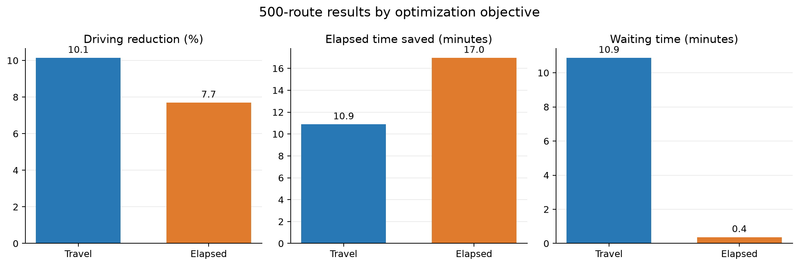
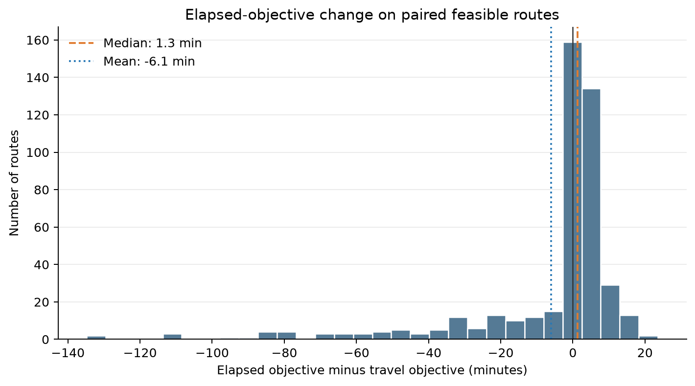
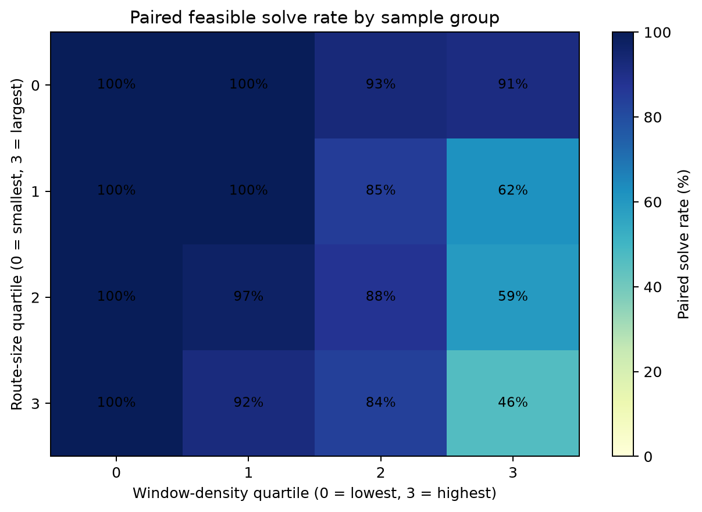

# Last-Mile Route Optimization

A route-level study of last-mile delivery sequencing using the Amazon Last Mile Routing Research Challenge dataset. The notebooks compare route sequences optimized for driving time with sequences optimized for total elapsed time under hard delivery time windows.

## Results from the 500-route sample

The sample was selected across route-size and time-window-density groups (random seed 43). Each selected route was tested under both objectives using a two-stage solver: a 5-second primary search followed by a 15-second fallback search when the primary search found no feasible solution.

- 446 of 500 routes (89.2%) had feasible results under both objectives.
- All 892 feasible route-objective results had zero time-window violations and visited every stop once.
- The travel objective reduced driving time by a mean of 10.14% (median 9.22%) versus historical routes. The elapsed objective reduced driving time by a mean of 7.70% (median 7.13%).
- Mean elapsed time saved versus historical routes was 10.89 minutes for the travel objective and 16.96 minutes for the elapsed objective.
- On the 446 paired routes, the elapsed objective changed elapsed time by a mean of -6.07 minutes and a median of +1.30 minutes relative to the travel objective. Negative means elapsed finished sooner. A small number of large waiting-time reductions pull the mean down; the median describes the typical route more closely.
- The remaining 54 routes were infeasible under the tested solver configurations and time limits. Their timeout or failure statuses do not establish that no feasible route order exists under any possible solver configuration.
- One checkpoint record reports a 15-second fallback timeout after only 0.13 seconds. This runtime inconsistency has not been independently reproduced, so that record should be treated cautiously.

### Figures







## Repository contents

- `notebooks/01_dataset_audit.ipynb` — data checks and sample preparation.
- `notebooks/02_route_optimization.ipynb` — route optimization and result analysis.
- `notebooks/03_reproduce_500_route_report.ipynb` — rebuilds the 500-route summary tables and charts from the committed results.
- `data/processed/evaluation_routes_500.csv` — 500-route sample metadata.
- `data/processed/optimization_500_final_outcomes.csv` — final per-route, per-objective results.
- `data/processed/optimization_500_final_objective_summary.csv` — objective-level summary.
- `data/processed/optimization_500_paired_comparison.csv` — paired objective comparisons.
- `data/processed/optimization_500_strata_solve_rates.csv` — solve rates by sample group.
- `data/processed/optimization_500_unresolved_by_group.csv` — unresolved counts by group.
- `data/processed/github_figures/` — generated figures.

Raw challenge data, per-route caches, temporary checkpoints, and the local Python environment are excluded from this repository. Obtain and extract the source data under its applicable terms into `data/raw/amazon/almrrc2021-data-training/model_build_inputs/`. Notebooks 01 and 02 find the project folder automatically when Jupyter starts from the project folder or its `notebooks/` folder, and show a clear error if the source data is missing.

## Reproduce the 500-route report

Notebook 03 uses the committed 500-route CSV files. It does not rerun the optimizer.

1. Clone this repository and open a terminal in the project folder.
2. Install the dependencies and Jupyter Notebook:

   ```bash
   python3 -m pip install -r requirements.txt
   python3 -m pip install notebook
   ```

3. Start Jupyter from the project folder:

   ```bash
   python3 -m notebook
   ```

4. Open `notebooks/03_reproduce_500_route_report.ipynb` and run the cells from top to bottom.

The notebook displays the summary tables and saves the charts to `data/processed/github_figures/`. Rerunning it will recreate those chart files on your computer.

## Methods and limitations

The analysis holds each route's assigned stop set fixed and reorders those stops. It compares a driving-time objective with an elapsed-time objective, while enforcing the modeled delivery time windows. Results describe this stratified 500-route sample and the configured solver strategies and time limits; they should not be interpreted as guaranteed performance across all routes or delivery networks. Group-level solve rates are descriptive, and unresolved routes may be solvable with different strategies or longer search.
